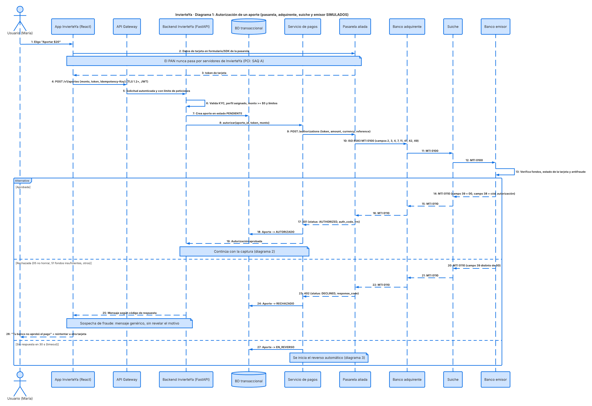
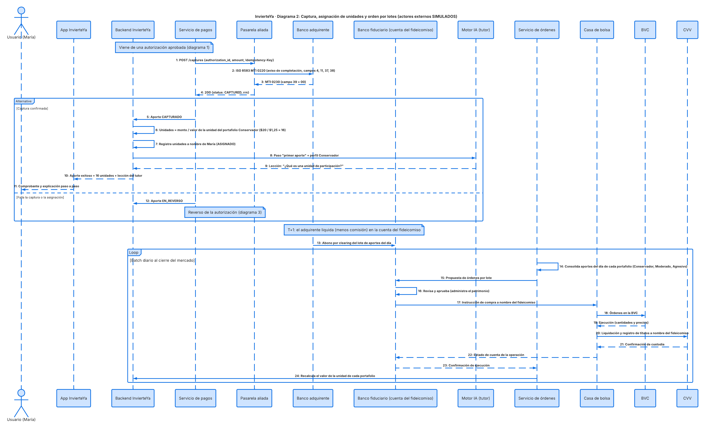
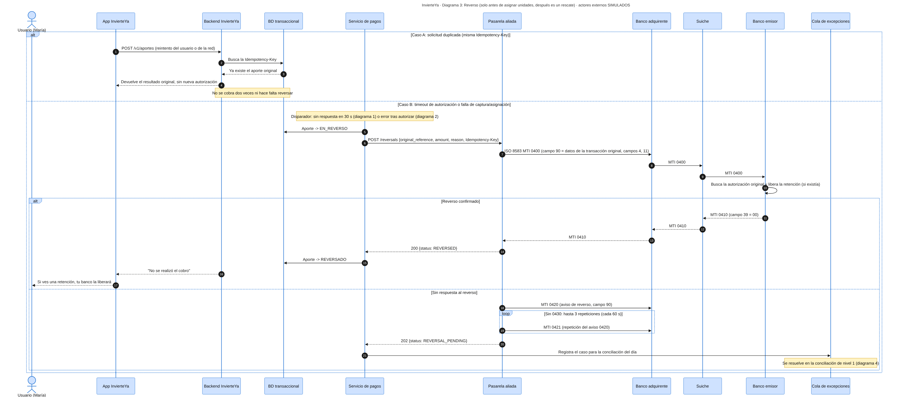
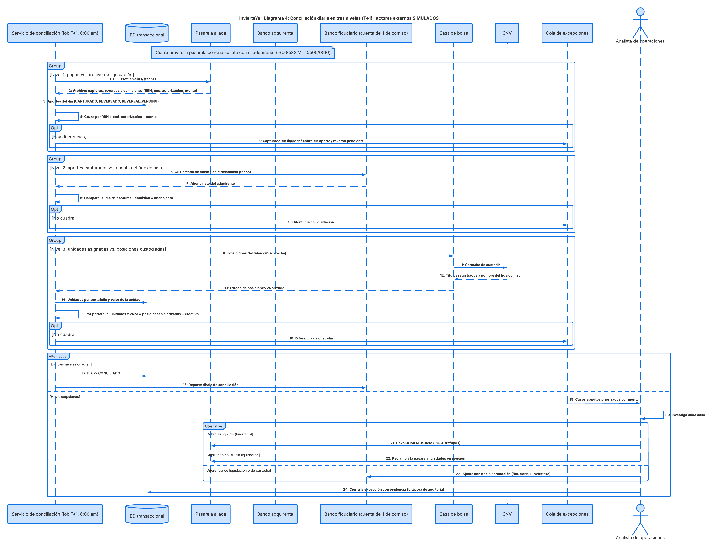

# Diagramas de secuencia · Flujo transaccional

**InvierteYa · Equipo D · Sesión 2** — Fuente Mermaid en `docs/diagramas/*.mmd` · Mapeo de campos en
`S2_EquipoD_API_ISO8583.pdf`

> **Simulado:** la pasarela aliada, el adquirente, el suiche, el emisor, el banco fiduciario, la casa
> de bolsa, la BVC y la CVV son servicios simulados del prototipo.

**Recorrido de punta a punta (María aporta \$20):** el usuario aporta → la pasarela aliada pide
autorización al emisor a través del adquirente y el **suiche** (ISO 8583 0100/0110) → se captura de
inmediato (0220/0230) → el dinero va a la cuenta del **fideicomiso** en el banco fiduciario → María
recibe **unidades de participación** → un batch diario agrupa los aportes en órdenes por lote que el
fiduciario aprueba y la casa de bolsa ejecuta en la BVC (custodia en la CVV) → al día siguiente se
**concilia en tres niveles**. Si algo falla antes de asignar unidades, se **reversa** (0400/0410).

**Rol del suiche:** enruta los mensajes ISO 8583 entre el banco adquirente y el banco emisor de la
tarjeta, y es la base del clearing con el que el adquirente liquida en T+1.

## Diagrama 1 · Autorización

Validaciones de InvierteYa (KYC, adhesión, perfil, monto, idempotencia) → `POST /authorizations` →
ISO 8583 **0100** (campos 2, 3, 4, 7, 11, 41, 42, 49) → **0110** con el campo 39. Si se rechaza, el
mensaje depende del código; el tutor no aparece. Timeout de 30 s → reverso.

## Diagrama 2 · Captura, asignación de unidades y orden por lotes

Captura inmediata (`POST /captures` → **0220/0230**). Las unidades se calculan como monto / valor de la
unidad del portafolio (\$20 / \$1,25 = 16) y aparece el tutor. Proceso separado: batch diario →
**InvierteYa propone y el fiduciario aprueba** → casa de bolsa → BVC → CVV a nombre del fideicomiso.

## Diagrama 3 · Reverso

Caso A: solicitud duplicada (misma `Idempotency-Key`) → se devuelve el resultado original, sin cobrar
dos veces. Caso B: timeout o falla después de autorizar → **0400** con el campo 90 (datos originales) →
**0410**. Si no hay respuesta → **aviso de reverso 0420** y hasta 3 repeticiones **0421** → cola de
excepciones. Solo se reversa **antes** de asignar unidades; después, cualquier devolución es un
**rescate**.

## Diagrama 4 · Conciliación en tres niveles (T+1, 6:00 am)

1. **Pagos vs. archivo de liquidación** de la pasarela y el suiche (monto, RRN del campo 37, código de
   autorización del campo 38). Antes, la pasarela concilia su lote con el adquirente (**0500/0510**).
2. **Aportes capturados vs. abono en la cuenta del fideicomiso** en el banco fiduciario.
3. **Unidades asignadas vs. posiciones custodiadas en la CVV.**

Las diferencias van a una cola de excepciones que resuelve un analista: devolución, reclamo a la
pasarela o ajuste con doble aprobación.

