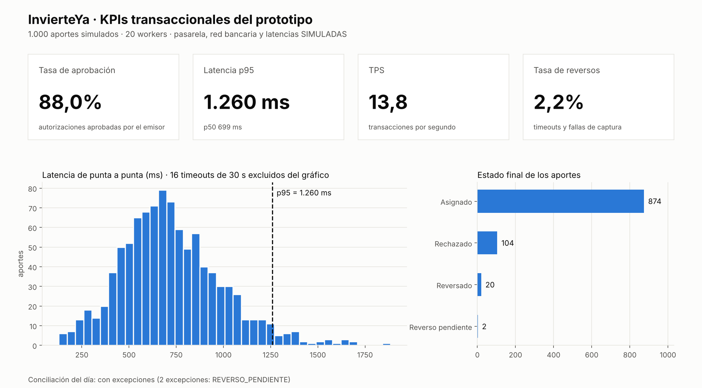

# Tablero de KPIs transaccionales

**InvierteYa · Equipo D · Sesión 2** — Script: `scripts/kpis.py` · Datos: `docs/kpis.json`

> **Simulado:** se midió sobre el prototipo con la pasarela simulada. Las latencias de la red bancaria,
> las tasas de rechazo y los timeouts son **supuestos del simulador**; el procesamiento del backend sí
> es real.

## Resultado (1.000 aportes, 20 usuarios concurrentes)

| KPI | Valor | Cómo se calcula |
|---|---|---|
| **Tasa de aprobación** | **88,0%** | Autorizaciones aprobadas por el emisor / intentos |
| **Latencia p95** | **1.260 ms** (1.259,5) | Percentil 95 del tiempo de punta a punta (pasarela simulada + backend real). p50: 699 ms |
| **TPS** | **13,8** | Aportes completados por segundo, con 20 workers sobre un reloj simulado |
| **Tasa de reversos** | **2,2%** | Reversos iniciados / intentos |



## Estados finales de los 1.000 aportes

| Estado | Cantidad |
|---|---|
| ASIGNADO (cobrado y con unidades) | 874 |
| RECHAZADO por el emisor (51, 05, 59) | 104 |
| REVERSADO (timeout o falla de captura) | 20 |
| REVERSO_PENDIENTE (sin respuesta al reverso) | 2 |

Los 2 reversos pendientes aparecen en la conciliación como **excepciones**, que es justo lo que debe
pasar: el sistema no los da por buenos y los envía a revisión (diagrama 4).

## Cómo leerlo

- El **p99 es de 30,3 s** porque incluye los timeouts (30 s), que disparan el reverso. Por eso el KPI
  pedido es el p95.
- La tasa de aprobación depende de los rechazos simulados (51, 05, 59) y de los timeouts. Con datos
  reales, se compara contra la tasa de la pasarela aliada.

## Cómo reproducirlo

```bash
python scripts/kpis.py --n 1000 --workers 20   # regenera docs/kpis.json y docs/kpis_tablero.png
```
