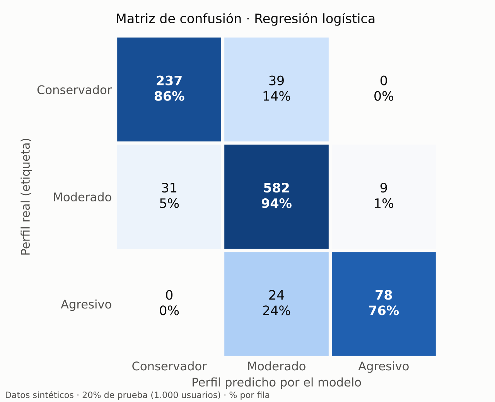
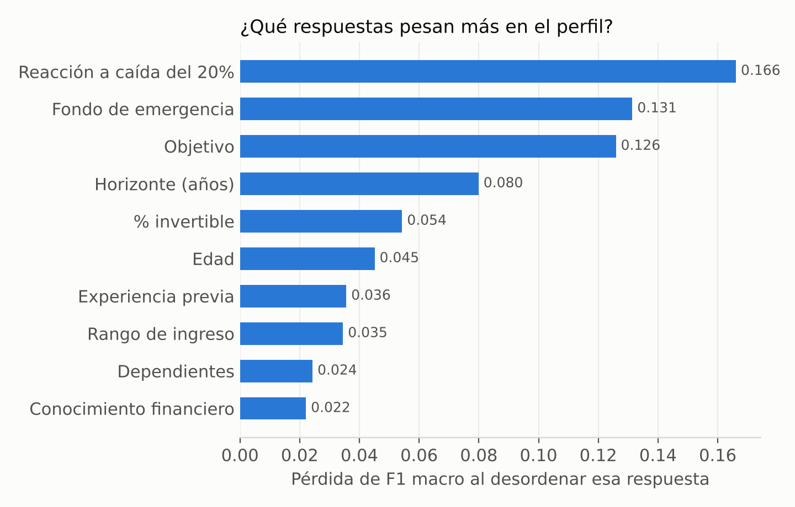

# Ficha del modelo baseline · Perfil de riesgo y tutor didáctico

**InvierteYa · Equipo D · Sesión 2 · Línea D (perfil de riesgo y recomendación de portafolio)**
Código: `ia/` · Métricas completas: `docs/ia/metricas.json` · Dataset: `docs/ia/DATASET.md`

> **Componente SIMULADO / baseline:** entrenado solo con datos sintéticos. Sirve para demostrar el
> flujo y medir contra las metas de la ficha de IA de la Sesión 1. No está listo para recomendar a
> personas reales.

## 1. Qué hace

Cuando el usuario termina el cuestionario de 10 preguntas, la IA tiene dos partes:

1. **Clasificador de perfil de riesgo** (este modelo). Devuelve Conservador, Moderado o Agresivo, la
   probabilidad de cada perfil y una explicación en lenguaje simple. El perfil define el portafolio
   del fideicomiso en el que se asignan las unidades.
2. **Tutor didáctico con contenido predefinido** (sin LLM). Selecciona la microlección adecuada según
   el perfil, el nivel de conocimiento y el paso del flujo (sección 8).

## 2. Resultado frente a las metas de la Sesión 1

Evaluación sobre el 20% de prueba (1.000 usuarios que el modelo no vio), con las reglas de seguridad
aplicadas:

| Meta (ficha de IA, Sesión 1) | Resultado | ¿Cumple? |
|---|---|---|
| Exactitud ≥ 85% | **89,7%** | ✅ |
| F1 por clase ≥ 0,80 | Conservador **0,87** · Moderado **0,92** · Agresivo **0,83** | ✅ |
| 0 Conservadores clasificados como Agresivos | **0** | ✅ |
| Sin fondo de emergencia nunca Agresivo | 0 casos (la regla se aplica después del modelo) | ✅ |
| Probabilidad < 60% → revisión humana | Marca el **5,2%** de los casos | ✅ |

Métricas adicionales (anticipo de la Sesión 3): **AUC macro (uno contra todos) = 0,978**.
Precisión por clase: 0,88 · 0,90 · 0,90. Recall por clase: 0,86 · 0,94 · 0,76.



**Lectura de la matriz.** Los errores solo ocurren entre perfiles **vecinos**: nunca se confunde
Conservador con Agresivo ni al revés. El error más frecuente es clasificar a un Agresivo como Moderado
(24 casos), que es el error **seguro**, porque recomienda menos riesgo del que la persona tolera. Solo
9 Moderados (1%) se clasificaron como Agresivos.

## 3. Modelos comparados

Ambos son modelos explicables, como se definió en la Sesión 1. Los hiperparámetros se eligieron con
validación cruzada estratificada de 5 pliegues sobre el 80% de entrenamiento (métrica: F1 macro).

| Modelo | Hiperparámetros elegidos | F1 macro (val. cruzada) | Exactitud (prueba) | F1 Agresivo | Conserv.→Agresivo | ¿Cumple todo? |
|---|---|---|---|---|---|---|
| Árbol de decisión | profundidad 8, hoja mín. 5 | 0,837 | 85,9% | 0,76 | 0 | ❌ (F1 Agresivo) |
| **Regresión logística multinomial** | C = 1, sin balanceo de clases | **0,886** | **89,7%** | **0,83** | **0** | ✅ **elegido** |

**Por qué gana la regresión logística.** La regla de idoneidad suma puntos de varias respuestas, y
una regresión logística también combina las respuestas de forma aditiva, así que la aproxima mejor.
Un árbol necesita muchos cortes para imitar una suma.

**Decisión sobre el balanceo de clases.** Con `class_weight="balanced"` el modelo clasificaba a 39
Moderados como Agresivos (recomendaba de más), y el F1 de Agresivo quedaba por debajo de 0,80 en 4 de
6 semillas. Sin balanceo, esos casos bajan a 9. Se eligió la opción que se equivoca hacia el lado
conservador.

## 4. Estabilidad

Se repitió todo el proceso (dataset nuevo + entrenamiento + evaluación) con 5 semillas distintas:

| Semilla | 1 | 7 | 99 | 123 | 2024 |
|---|---|---|---|---|---|
| Exactitud | 90,8% | 92,0% | 89,8% | 90,2% | 91,0% |
| F1 mínimo por clase | 0,857 | 0,854 | 0,802 | 0,800 | 0,833 |
| Conservador→Agresivo | 0 | 0 | 0 | 0 | 0 |

La exactitud promedio es de 90,8% y nunca aparece el error grave. **Límite honesto:** el F1 de la clase
Agresivo queda justo en el borde de la meta (peor caso 0,800). Es la clase minoritaria y la primera
que hay que vigilar.

## 5. Sesgo: métricas por grupo

Mitigación comprometida en la Sesión 1: revisar que el modelo no trate distinto a un grupo (por
ejemplo, "siempre clasificar a los jóvenes como agresivos").

| Grupo | n | Exactitud | F1 macro | % Agresivo real | % Agresivo predicho |
|---|---|---|---|---|---|
| Edad 18-24 | 277 | 89,9% | 0,89 | 13,4% | 12,3% |
| Edad 25-40 | 525 | 88,9% | 0,85 | 9,5% | 7,4% |
| Edad 41+ | 198 | 91,4% | 0,89 | 7,6% | 7,1% |
| Ingreso bajo (1-2) | 539 | 89,4% | 0,83 | 3,5% | 3,0% |
| Ingreso medio (3) | 234 | 89,7% | 0,86 | 12,8% | 9,8% |
| Ingreso alto (4-5) | 227 | 90,3% | 0,89 | 23,4% | 21,2% |

La exactitud es pareja entre grupos (88,9% a 91,4%), y en ningún grupo el modelo predice **más**
Agresivos de los que hay en realidad: no exagera el riesgo de los jóvenes. El F1 más bajo está en el
ingreso bajo (0,83), porque ahí casi no hay Agresivos. Es un punto a vigilar con datos reales.

## 6. Explicabilidad



Importancia por permutación: se desordena una respuesta a la vez y se mide cuánto empeora el F1. Las
respuestas que más pesan son la **reacción ante una caída del 20%**, el **fondo de emergencia** y el
**objetivo**. Las tres son preguntas de actitud ante el riesgo, que es lo que se busca medir. La edad
y el ingreso pesan poco.

Además, cada respuesta de la API incluye una **explicación en lenguaje simple** (por ejemplo: "Te
asignamos el perfil Conservador sobre todo porque prefieres proteger tu dinero y venderías ante una
caída del 20%").

## 7. Reglas de seguridad y supervisión humana

El orden de decisión está implementado en `ia/predictor.py` y `app/core/servicio.py`:

1. El modelo estima la probabilidad de cada perfil.
2. **Regla no negociable:** sin fondo de emergencia nunca Agresivo (pasa a Moderado).
3. **Probabilidad < 60% → revisión humana:** el caso entra a la cola de un asesor
   (`revisiones_perfil`). Mientras tanto se asigna **provisionalmente el perfil más conservador**
   entre el modelo y las reglas, y el usuario ve un aviso.
4. **Respaldo:** si el modelo no se puede cargar, la API usa las reglas de `app/core/perfil.py` y lo
   indica en el campo `motor`. La demo nunca se cae por el modelo.

### Integración en la API

`POST /v1/usuarios/{id}/perfil` devuelve, además de lo que ya devolvía, estos campos nuevos:
`probabilidad`, `probabilidades` (los 3 perfiles), `revision_humana`, `perfil_reglas` (para comparar) y
`motor` (qué decidió: el modelo o las reglas). Están documentados en `docs/openapi.yaml`.

### Casos de prueba (`tests/test_ia.py`)

| Caso | Qué verifica |
|---|---|
| CP-16 | El modelo cumple las 3 metas en el 20% de prueba |
| CP-17 | Con el modelo conectado, sin fondo de emergencia nunca sale Agresivo |
| CP-18 | Probabilidad < 60% → revisión humana y perfil provisional más conservador |
| CP-19 | Sin modelo disponible, la API sigue funcionando con las reglas |
| CP-20 | El dataset es reproducible y solo tiene columnas sintéticas (sin datos personales) |
| CP-21 | La exactitud de cada grupo de edad es ≥ 80% |

## 8. Tutor didáctico (contenido predefinido)

**Decisión del equipo:** no se usa un LLM. El contenido lo escribe y revisa una persona, así que no hay
alucinaciones ni promesas de rendimiento. La parte "inteligente" es la **regla de selección**
(`app/core/tutor.py`):

1. Solo lecciones del **paso del flujo** en el que está el usuario.
2. Primero las del **perfil exacto** del usuario y luego las marcadas "Todos".
3. Primero las de su **nivel** (conocimiento 1-2 → básico; 3-5 → intermedio).
4. **Nunca repite** una lección que el usuario ya vio.
5. **No aparece cuando se rechaza un pago:** InvierteYa no conoce la causa real; solo se muestra un
   mensaje según el código de respuesta.

Momentos del flujo en que aparece: fin del cuestionario, firma de la adhesión (antes del primer aporte),
asignación de unidades, consulta del portafolio y antes de un rescate.

**Catálogo de lecciones** (tabla `id`, `paso_del_flujo`, `perfil`, `nivel`, `texto`):

| id | Paso del flujo | Perfil | Nivel | Título | Texto |
|---|---|---|---|---|---|
| L01 | `CUESTIONARIO_COMPLETO` | Conservador | básico | ¿Qué significa ser Conservador? | Prefieres no perder dinero aunque eso signifique ganar menos. Por eso tu portafolio tiene sobre todo renta fija: instrumentos que pagan intereses conocidos de antemano. |
| L02 | `CUESTIONARIO_COMPLETO` | Moderado | básico | ¿Qué significa ser Moderado? | Aceptas algunos altibajos a cambio de que tu dinero crezca más. Tu portafolio combina renta fija, fondos y acciones en partes parecidas. |
| L03 | `CUESTIONARIO_COMPLETO` | Agresivo | básico | ¿Qué significa ser Agresivo? | Buscas el mayor crecimiento posible y toleras caídas temporales. Tu portafolio tiene más acciones, que pueden subir mucho pero también bajar. |
| L04 | `ANTES_PRIMER_APORTE` | Todos | básico | ¿Dónde queda mi dinero? | Tu dinero no queda en InvierteYa: entra a un fideicomiso administrado por un banco regulado. Ese patrimonio está separado del banco y de nosotros. |
| L05 | `UNIDADES_ASIGNADAS` | Todos | básico | ¿Qué es una unidad de participación? | Es tu parte del fideicomiso. Si aportaste $20 y cada unidad vale $1,25, recibiste 16 unidades. Si las inversiones suben, el valor de cada unidad sube y tu saldo también. |
| L06 | `UNIDADES_ASIGNADAS` | Todos | intermedio | ¿Por qué compramos por lotes? | Juntamos los aportes de muchas personas y el fideicomiso compra títulos completos una vez al día. Así una inversión de $5 accede a instrumentos que normalmente piden mucho más. |
| L07 | `VER_PORTAFOLIO` | Conservador | básico | ¿Qué es la renta fija? | Es prestarle dinero a una empresa o al Estado a cambio de intereses. Es la parte más estable de tu portafolio, aunque no está libre de riesgo. |
| L08 | `VER_PORTAFOLIO` | Todos | básico | ¿Por qué sube y baja mi saldo? | El valor de tu unidad cambia con el precio de los títulos del fideicomiso. Una baja de un día es normal; lo importante es tu horizonte de inversión. |
| L09 | `VER_PORTAFOLIO` | Agresivo | intermedio | Diversificar no es opcional | Aunque tu perfil acepte más riesgo, repartir el dinero entre varios instrumentos reduce el golpe si a uno le va mal. |
| L10 | `ANTES_RESCATE` | Todos | básico | Antes de retirar | Retirar se llama rescatar unidades: se venden al valor del día. Si el mercado está bajo, podrías recibir menos de lo que aportaste. |

## 9. Limitaciones

- **Datos sintéticos:** el modelo aprende a imitar la regla de idoneidad del equipo (con ruido). Una
  exactitud alta no prueba que la recomendación sea adecuada para personas reales. Antes de producción
  hay que validar la regla con un asesor certificado y reentrenar con datos reales anonimizados.
- **El cero Conservador→Agresivo** se da en parte porque en los datos sintéticos esos perfiles están
  lejos (≥ 6 puntos de diferencia). Con datos reales debe seguir siendo una prueba bloqueante.
- **La clase Agresivo es frágil** (10% de los datos, F1 de 0,80 a 0,86 según la semilla).
- **No detecta respuestas incoherentes o apresuradas** (riesgo 3 de la ficha). Las preguntas de control
  quedan para la Sesión 3.
- **Versión de scikit-learn:** el modelo se guardó con la versión indicada en `metricas.json`. Si el
  equipo usa otra, basta con correr `python ia/entrenar.py` para regenerarlo.

## 10. Cómo reproducirlo

```bash
python ia/generar_dataset.py   # data/dataset_sintetico.csv
python ia/entrenar.py          # modelo + metricas.json + gráficos (unos 20 s)
python -m pytest -v            # 21 casos: CP-01 a CP-21
```

## 11. Fuentes

- Pedregosa, F. et al. (2011). *Scikit-learn: Machine Learning in Python*. Journal of Machine Learning
  Research, 12, 2825-2830. Biblioteca usada para los modelos y las métricas.
- scikit-learn 1.9.1. *3.4. Metrics and scoring: quantifying the quality of predictions*. Definición de
  F1 por clase y F1 macro, y convención de la matriz de confusión (filas = clase real, columnas = clase
  predicha). https://scikit-learn.org/stable/modules/model_evaluation (consultado el 8-nov-2026).
- scikit-learn 1.9.1. *sklearn.inspection.permutation_importance*. La importancia es la caída del
  puntaje al desordenar una columna.
  https://scikit-learn.org/stable/modules/generated/sklearn.inspection.permutation_importance.html
  (consultado el 8-nov-2026).
- Equipo D (2026). *S1_EquipoD_Concepto*, sección 7: ficha del componente de IA (metas, riesgos y
  mitigaciones).
