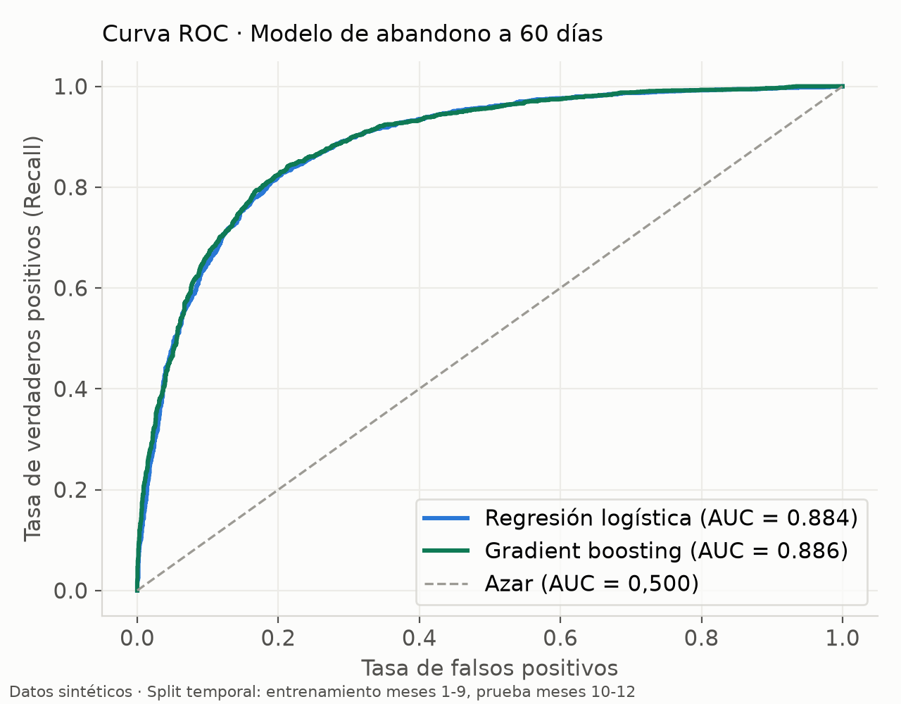
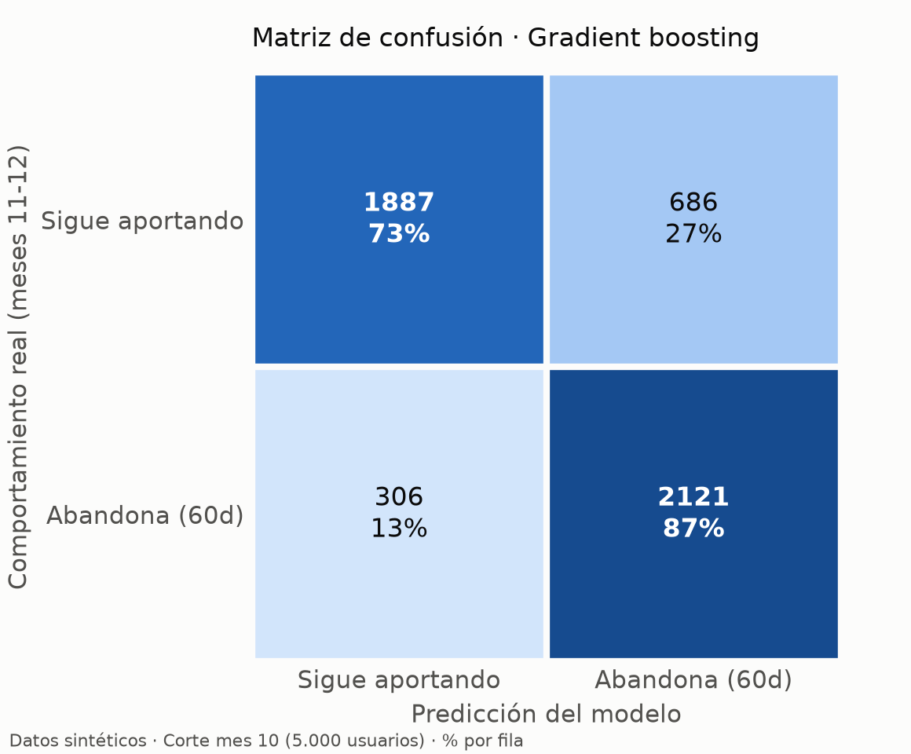
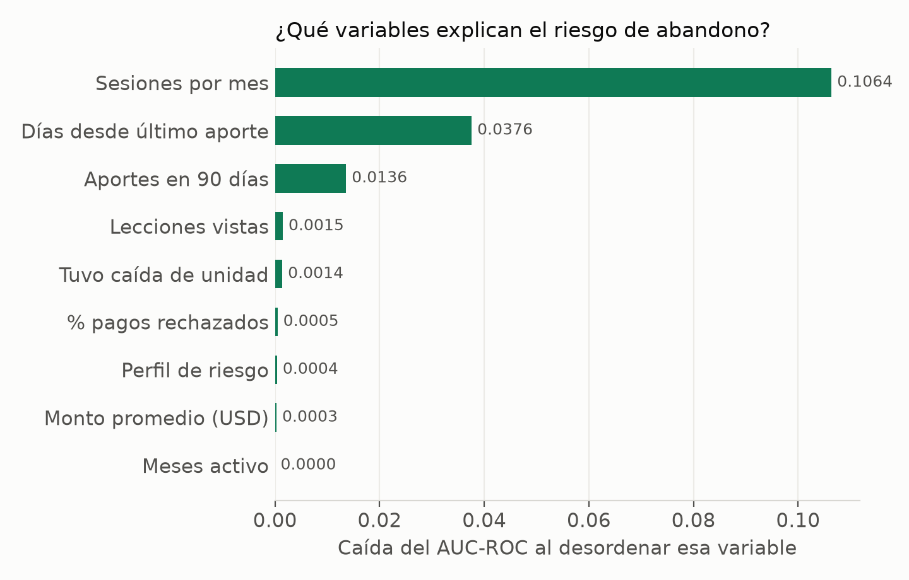
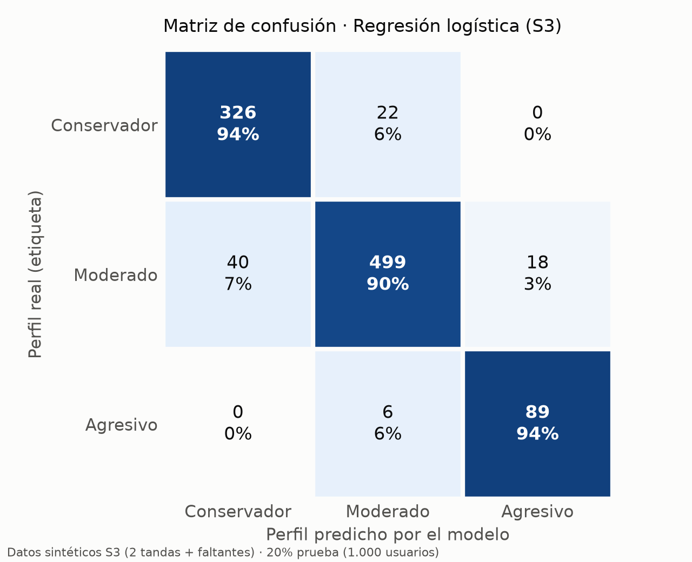
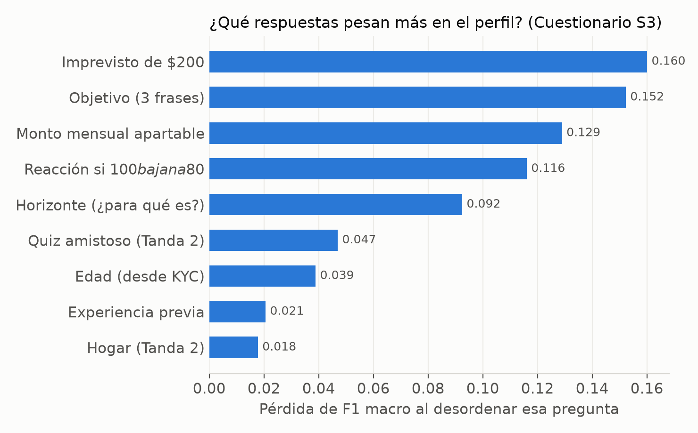
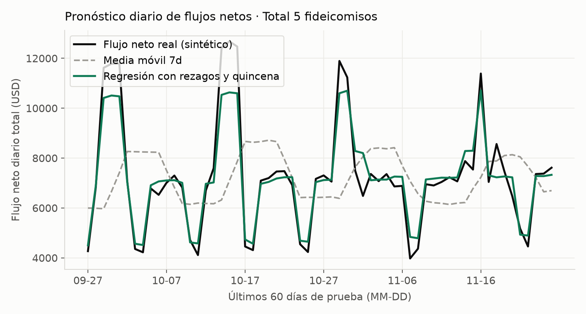

# Model Card · Sistema de IA de InvierteYa (Sesión 3)

**InvierteYa · Equipo D · Sesión 3 (MVP Seguro con IA Integrada)**  
**Versión:** 2.0 (Sesión 3) · **Fecha:** 25-nov-2026  
**Código y artefactos:** `ia/`, `docs/ia/metricas.json`, `docs/ia/metricas_abandono.json`, `docs/ia/metricas_flujos.json`

> **Aviso de alcance (MVP académico):** todos los modelos descritos en esta Model Card fueron
> entrenados y evaluados con **datos 100% sintéticos** (cero personas ni tarjetas reales). Todas las
> métricas reportadas se calcularon ejecutando código reproducible con `scikit-learn 1.9.1`.

---

## 1. Arquitectura de IA (de 2 a 5 piezas)

Atendiendo la retroalimentación de la Sesión 2 (*"IA predictiva, no solo didáctica"* y *"confianza en el
cuestionario"*), la IA de InvierteYa se organiza en cinco componentes:

| # | Componente | Qué predice / hace | Destinatario | Estado S3 |
|---|---|---|---|---|
| 1 | **Clasificador de perfil v2** | Perfil (`CONSERVADOR`, `MODERADO`, `AGRESIVO`) con cuestionario conversacional en 2 tandas y manejo de *"Prefiero no decirlo"* | Usuario y banco fiduciario (idoneidad del catálogo) | **Reentrenado y medido** |
| 2 | **Tutor didáctico predefinido** | Selecciona microlecciones redactadas por humanos según paso, perfil y nivel (sin LLM → 0 alucinaciones) | Usuario | **Integrado (S2/S3)** |
| 3 | **Abandono del ahorro (60d)** | Probabilidad de que el usuario no realice aportes en los próximos 60 días | Usuario (aviso suave) y negocio (retención) | **Construido y medido (S3)** |
| 4 | **Pronóstico de flujos** | Aportes netos diarios y semanales por fideicomiso | Banco fiduciario y casa de bolsa (lote diario) | **Versión simple medida (S3)** |
| 5 | **Rescate anticipado y Cambio de perfil** | Probabilidad de rescate en 30d / contradicción entre conducta y perfil declarado | Fiduciario (liquidez) / Usuario + Cumplimiento | **Diseñados (S3) → S4** |

---

## 2. Modelo 1 · Abandono del ahorro a 60 días (Nuevo S3)

### 2.1 Propósito y datos
- **Objetivo:** identificar de forma temprana a usuarios en riesgo de pausar su ahorro en los próximos 60
  días para mostrarles un recordatorio opcional y amable en el portafolio (*"¿Quieres programar tu aporte
  de \$10 cada quincena?"*).
- **Dataset:** `data/dataset_comportamiento.csv` (5.000 usuarios sintéticos × 12 meses = 58.004 filas;
  detalle en `docs/ia/DATASET_COMPORTAMIENTO.md`).
- **Variables (9):** `meses_activo`, `aportes_90d`, `dias_desde_ultimo_aporte`, `pct_pagos_rechazados`,
  `sesiones_por_mes`, `lecciones_vistas`, `perfil`, `monto_promedio`, `tuvo_caida_unidad`.
- **Validación estrictamente temporal (cero fuga del futuro):**
  - Entrenamiento y calibración de umbral: cortes meses **3 a 7** (25.000 filas; todas las etiquetas
    observan meses $\le 9$).
  - Prueba final no vista: corte mes **10** (5.000 usuarios; etiquetas observan meses **11 y 12**).

### 2.2 Comparación de modelos y métricas (meses 10–12)

Metas fijadas en el plan: **AUC ≥ 0,80** y **Recall ≥ 0,70** en la clase *"Abandona"* (preferimos enviar
un recordatorio de más que dejar perder el hábito de ahorro).

| Modelo | Hiperparámetros | Umbral | Exactitud | Precisión | Recall (Abandona) | F1 | AUC-ROC | ¿Cumple metas? |
|---|---|---:|---:|---:|---:|---:|---:|---|
| Regresión logística | `C = 5,0` | 0,40 | 79,2% | 0,732 | **0,902** | 0,808 | 0,884 | ✅ |
| **Gradient Boosting (`HistGradientBoosting`)** | `max_depth = 3`, `lr = 0,05` | **0,34** | **80,2%** | **0,756** | **0,874** | **0,811** | **0,886** | ✅ **Elegido** |

- **Lectura de la matriz de confusión (5.000 usuarios en prueba):** 2.121 abandonos detectados
  correctamente (verdaderos positivos), 306 no detectados (falsos negativos), 1.887 activos correctamente
  identificados y 686 falsos positivos (usuarios activos que ven un recordatorio no intrusivo).





### 2.3 Explicabilidad e importancia de variables



Por permutación sobre AUC-ROC, las señales dominantes son la **frecuencia de sesiones en la app**
(`0,1064`), los **días desde el último aporte** (`0,0376`) y los **aportes en los últimos 90 días**
(`0,0136`), seguidos por las lecciones vistas (`0,0015`) y la caída del valor de la unidad (`0,0014`).
En la API (`GET /v1/usuarios/{id}/riesgo-abandono`), `ia/predictor_abandono.py` traduce el estado del
usuario en hasta 3 factores legibles en español y una sugerencia suave (con respaldo automático por reglas
si el archivo del modelo no está disponible).

### 2.4 Auditoría de sesgo por grupo (edad y capacidad de ahorro)

Aunque `edad` y `ahorro_mensual_rango` **no son entradas del modelo de abandono**, se audita su desempeño
por subgrupo (continuidad de CP-21):

| Subgrupo | n | AUC-ROC | Precisión | Recall | F1 | Tasa real abandono | Tasa alerta |
|---|---:|---:|---:|---:|---:|---:|---:|
| Edad 18–24 | 918 | 0,891 | 0,781 | 0,868 | 0,822 | 50,4% | 56,1% |
| Edad 25–40 | 3.098 | 0,886 | 0,751 | 0,877 | 0,809 | 48,5% | 56,6% |
| Edad 41+ | 984 | 0,884 | 0,747 | 0,868 | 0,803 | 47,1% | 54,7% |
| Ahorro bajo (\$5–\$50) | 3.371 | 0,885 | 0,766 | 0,894 | 0,825 | 52,5% | 61,4% |
| Ahorro alto (\$50+) | 1.629 | 0,882 | 0,728 | 0,819 | 0,771 | 40,3% | 45,4% |

El AUC se mantiene parejo entre `0,882` y `0,891` en todos los grupos de edad y capacidad de ahorro. El
recall es algo mayor en ahorro bajo (`0,894` vs `0,819`) en proporción directa a su tasa base más alta
(52,5% vs 40,3%), lo que en este caso de uso benigno implica ofrecer más recordatorios de apoyo.

---

## 3. Modelo 2 · Clasificador de perfil de riesgo v2 (Reentrenado S3)

### 3.1 Qué cambió frente a la Sesión 2 (Comentario #4)
- **Edad desde KYC:** ya no se pregunta en el cuestionario.
- **Preguntas situacionales en 2 tandas:** 6 preguntas antes del primer aporte (monto mensual apartable,
  *"¿para qué es este dinero?"*, 3 frases de objetivo, mini gráfico \$100→\$80, imprevisto de \$200,
  experiencia en productos) y 3 preguntas opcionales después (*"Afinemos tu perfil"*: hogar + 2 preguntas
  de quiz amistoso).
- **Salida cómoda *"Prefiero no decirlo"*:** en el dataset sintético S3, **11,3%** omite el monto mensual
  y **5,9%** omite la pregunta de imprevisto; **21,3%** invierte inicialmente con solo Tanda 1. El modelo
  imputa de forma prudente con indicadores de faltante y mantiene la regla dura: **si responde `"no_podria"`
  u omite el imprevisto, nunca se asigna Agresivo**.

### 3.2 Resultados en el 20% de prueba (1.000 usuarios sintéticos)

| Meta | Resultado S3 (`regresion_logistica`, C=10) | Árbol de decisión (comparado) | ¿Cumple? |
|---|---|---|---|
| Exactitud ≥ 85% | **91,4%** | 86,5% | ✅ |
| F1 por clase ≥ 0,80 | Conservador **0,913** · Moderado **0,921** · Agresivo **0,881** | 0,884 / 0,877 / **0,725** (❌) | ✅ |
| 0 Conservador → Agresivo | **0** | 0 | ✅ |
| AUC macro (OvR) | **0,986** | 0,932 | ✅ |
| Revisión humana (< 60% prob.) | **4,6%** de los casos | 3,8% | ✅ |

- **Precisión por clase:** Conservador `0,891` · Moderado `0,947` · Agresivo `0,832`.
- **Recall por clase:** Conservador `0,937` · Moderado `0,896` · Agresivo `0,937`.
- **Estabilidad (5 semillas adicionales):** exactitud media **92,1%** (mín. 91,1%), **0 Conservador→Agresivo**
  en todas las semillas, peor F1 mínimo por clase `0,795` (semilla 7; promedio `0,852`), confirmando que
  la clase Agresivo (9,5% del total) sigue siendo la primera a monitorear.





### 3.3 Auditoría de sesgo y manejo de faltantes (Perfil v2)

| Dimensión | Subgrupo | n | Exactitud | F1 macro | % Agresivo real | % Agresivo predicho |
|---|---|---:|---:|---:|---:|---:|
| Edad | 18–24 | 249 | 90,0% | 0,886 | 12,5% | 15,3% |
| Edad | 25–40 | 552 | 92,0% | 0,910 | 9,4% | 10,3% |
| Edad | 41+ | 199 | 91,5% | 0,915 | 6,0% | 6,0% |
| Ahorro | Bajo (\$5–\$50) | 539 | 92,2% | 0,875 | 3,9% | 4,8% |
| Ahorro | Alto (\$50+) | 346 | 89,6% | 0,895 | 21,1% | 22,8% |
| Ahorro | **Prefiero no decir** | 115 | **93,0%** | 0,845 | 0,9% | 1,7% |
| Tanda | **Solo Tanda 1** | 227 | **90,3%** | 0,891 | 4,4% | 5,7% |
| Tanda | Tanda 1 y 2 | 773 | 91,7% | 0,909 | 11,0% | 12,2% |

En todos los grupos la exactitud supera el **89,6%**. Quienes eligen *"Prefiero no decir"* o completan solo
Tanda 1 reciben clasificaciones prudentes (apenas 1,7% y 5,7% de perfiles Agresivos respectivamente).

---

## 4. Modelo 3 · Pronóstico simple de flujos para el fiduciario (S3)

Evaluado sobre `data/dataset_flujos_diarios.csv` (305 días de entrenamiento, últimos **60 días de prueba**)
para los 5 fideicomisos del catálogo:

| Enfoque | MAE diario total (USD) | MAPE total (%) | Observación |
|---|---:|---:|---|
| Media móvil (7 días) | \$1.968,38 | 28,86% | No captura picos de quincena ni caída de fin de semana |
| **Regresión Ridge (rezagos 1d/7d + quincena + fin de semana)** | **\$480,01** | **6,23%** | **Elegido** — reduce el error porcentual en 4,6× |

**Desglose por fideicomiso (modelo elegido, próximos horizontes para lote del fiduciario):**

| Fideicomiso | Flujo neto mañana | Flujo neto 7 días | MAE diario (USD) | MAPE (%) |
|---|---:|---:|---:|---:|
| Liquidez USD (`liq_usd`) | \$1.286,64 | \$9.944,82 | \$121,98 | 9,47% |
| Renta Fija USD (`rf_usd`) | \$2.310,72 | \$17.889,82 | \$261,59 | 11,44% |
| Mixto Balanceado (`mix_bal`) | \$2.069,07 | \$16.219,96 | \$192,12 | 9,22% |
| Acciones BVC (`acc_bvc`) | \$1.164,03 | \$9.097,48 | \$108,96 | 9,03% |
| Crecimiento Bolívares (`crec_ves`) | \$555,69 | \$4.331,06 | \$52,37 | 10,06% |
| **Total 5 fideicomisos** | **\$7.386,15** | **\$57.483,14** | **\$480,01** | **6,23%** |



---

## 5. Diseño de modelos para Sesión 4

1. **Rescate anticipado (30 días):** clasificación binaria + regresión de monto esperado para que el banco
   fiduciario estime cuánto efectivo mantener líquido por fideicomiso. Variables: rescates previos,
   caídas del valor de la unidad, antigüedad y perfil. Métricas objetivo: precisión, recall y AUC.
2. **Cambio de perfil (gobernanza S4):** detector basado en reglas de consistencia entre comportamiento
   real (p. ej., rescatar el 100% ante una caída menor siendo perfil Agresivo) y respuestas declaradas.
   Dispara invitación a repetir el cuestionario y revisión humana de cumplimiento; nunca cambia el perfil
   en automático.

---

## 6. Límites no negociables, supervisión humana y ética

- **Ningún modelo mueve dinero ni cambia el perfil por sí solo:** solo sugiere. Todo cambio de perfil o
  elección de un fideicomiso *"Por encima de tu perfil"* exige confirmación expresa del usuario o revisión
  de un asesor humano.
- **No se predicen rendimientos del mercado ni se prometen ganancias:** recomendar valores individuales o
  prometer retornos implicaría asesoría de inversión regulada (riesgo legal SUNAVAL). Todo rendimiento
  histórico simulado lleva el aviso *"no garantiza resultados futuros"*.
- **El modelo de abandono solo ayuda a ahorrar:** nunca se usa para subir comisiones, limitar acceso ni
  ejercer presión comercial abusiva (`accion_permitida = "SOLO_SUGERIR_RECORDATORIO"`).
- **Transparencia y contestabilidad en la app:**
  - Aviso visible: *"Esta sugerencia la hace un modelo automático; tú decides y un asesor puede revisarla"*.
  - Explicación en lenguaje simple (`explicacion`, `factores_suben`, `factores_moderan`) + contrafactuales
    (`que_cambiaria`: qué respuesta movería el perfil).
  - Botón **"No estoy de acuerdo con mi perfil"** que registra una solicitud de revisión humana
    (`POST /v1/usuarios/{id}/perfil/revision`), complementando la revisión automática bajo 60% de confianza.
- **Privacidad de entrenamiento:** en producción los modelos solo entrenan sobre la **capa Plata
  (seudonimizada)**, sin nombre, cédula ni PAN.
- **Limitación conocida:** al ser datasets sintéticos, las distribuciones y correlaciones reflejan los
  supuestos del equipo y deberán recalibrarse con datos reales autorizados antes de salida a producción.

---

## 7. Reproducibilidad y pruebas (`CP-16` a `CP-29`)

```bash
python ia/generar_dataset.py                  # dataset perfil S3 (5.000 usuarios)
python ia/entrenar.py                         # entrena perfil v2 + metricas.json + gráficos
python ia/generar_dataset_comportamiento.py   # dataset abandono (5.000×12m) + flujos diarios (365d)
python ia/entrenar_abandono.py                # entrena abandono + ROC + confusión + importancia
python ia/pronostico_flujos.py                # evalúa media móvil vs regresión + gráfico flujos
python -m pytest -v tests/test_ia.py tests/test_ia_s3.py
```

---

## 8. Fuentes primarias citadas

- Mitchell, M. et al. (2019). *Model Cards for Model Reporting*. Proceedings of the Conference on Fairness,
  Accountability, and Transparency (FAT* '19), ACM, pp. 220–229. https://dl.acm.org/doi/10.1145/3287560.3287596
- Pedregosa, F. et al. (2011). *Scikit-learn: Machine Learning in Python*. JMLR 12, 2825–2830.
- scikit-learn 1.9.1 Documentation — *Metrics and scoring (ROC-AUC, precision, recall, F1, MAE)* y
  *HistGradientBoostingClassifier*. https://scikit-learn.org/stable/modules/model_evaluation.html
- Equipo D (2026). *InvierteYa · Plan Sesión 3 y respuesta a la retroalimentación de la Sesión 2*.
